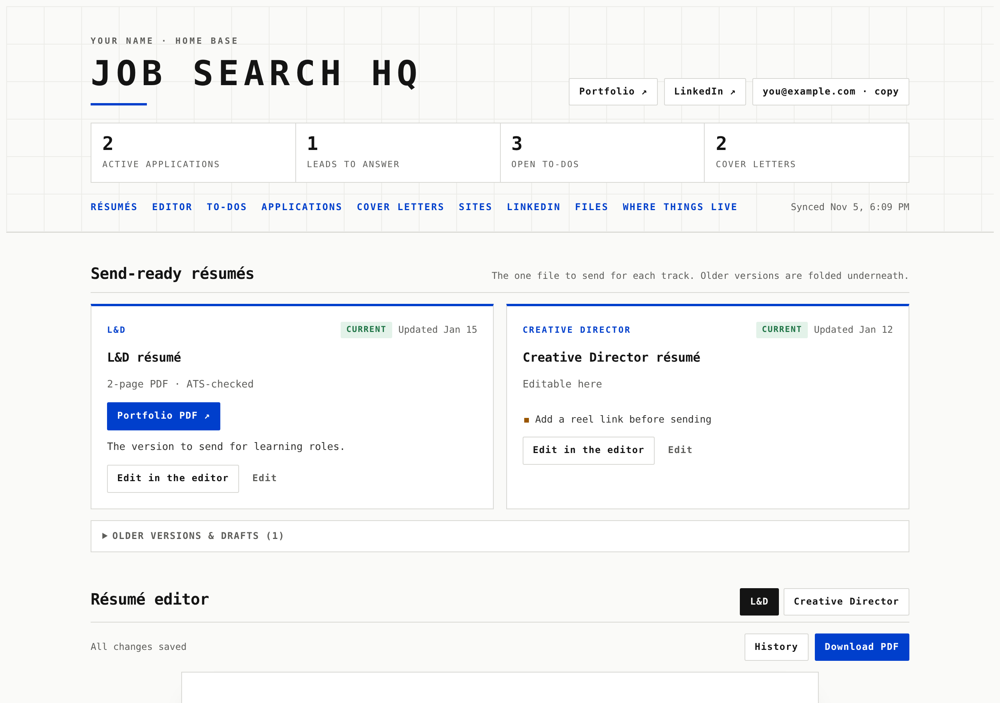
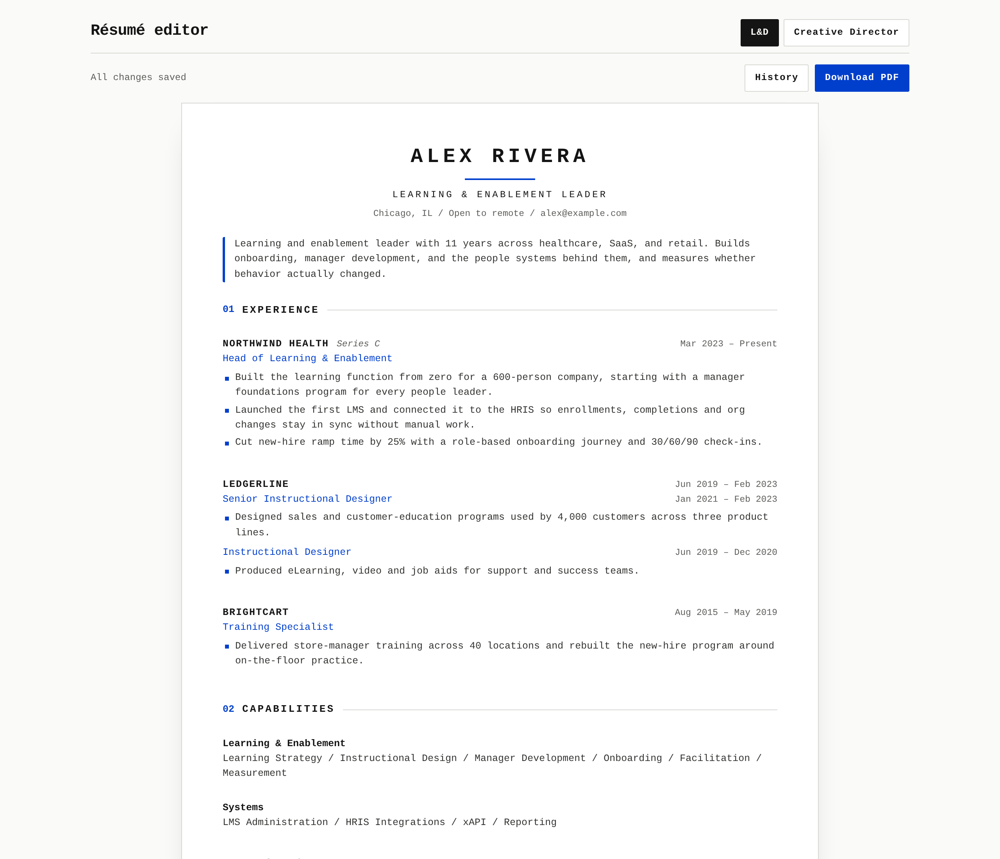
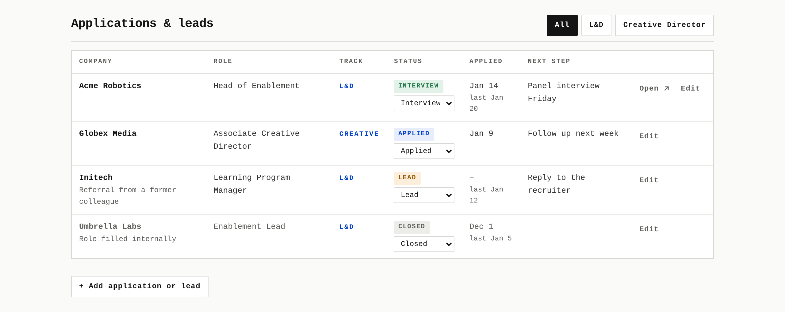

# unmplyd

**A single-page home base for a job search.** Your current résumés, cover letters, applications, to-dos, portfolio links and LinkedIn copy all sit on one page, so you stop digging through old chats and folders to find the version you actually sent.

It's one HTML file. It runs two ways:

- **As a Claude artifact.** Published on claude.ai, your data is stored server-side, Claude can update it for you from any chat, and the résumé editor gets an **Ask Claude** button for prompted edits.
- **Standalone.** Open it from any static web server. Data lives in your browser's local storage. No account, no backend, no build step.



## What's on the page

| Section | What it does |
|---|---|
| **Send-ready résumés** | The current version for each track, with flags for anything that needs fixing before you send it. |
| **Résumé editor** | Edit your résumé right on the page. Enter adds a bullet, Backspace on an empty bullet deletes it, and changes autosave. **Save version** keeps a named copy you can restore later, and one is saved automatically before any Claude edit. **Download PDF** produces a clean 2-page, ATS-friendly PDF in JetBrains Mono. **Ask Claude** (artifact mode) rewrites to your instruction and shows a diff before anything changes. |
| **Needs attention** | A short to-do list grouped by area. |
| **Applications & leads** | One row per role, with an inline status picker (Lead → Drafted → Applied → In review → Interview → Offer → Closed), last-touch date and next step. Filter by track. |
| **Cover letters** | Current letters by company, flagged when one is stale or needs a fix. |
| **Sites & portfolio** | Your live sites and profiles. |
| **LinkedIn copy** | Headline, About and other drafts, each with a copy button. |
| **File drawer** | Upload PDFs and other files (artifact mode). |
| **Where things live** | Links to the chats, folders and drives where originals are kept. |

<p>
  
  
</p>

The page supports any number of **tracks**: two different kinds of roles you're going after, each with its own résumé. The default config ships with two ("L&D" and "Creative Director") because that's what it was built for. Rename them or add more.

## Quick start (standalone)

```bash
git clone https://github.com/iclickthemouse/unmplyd.git
cd unmplyd
python3 -m http.server 8000
# open http://localhost:8000
```

On first load it fills itself from `examples/seed.json`, a fictional job seeker named Alex Rivera. To start clean, run `localStorage.clear()` in the browser console, point `seedUrl` at your own file, and reload.

Opening `index.html` straight from disk (`file://`) mostly works, but browsers block the `fetch` calls for the seed and the PDF fonts. Use a local server.

## Make it yours

Edit the `HQ_CONFIG` block near the top of `index.html`:

```js
window.HQ_CONFIG = Object.assign({
  appName: "Job Search HQ",
  owner: "Your Name",            // masthead, PDF metadata, Claude prompts
  email: "you@example.com",
  quickLinks: [ { label: "Portfolio", url: "https://example.com" } ],
  tracks: [ { id: "L&D", label: "L&D" }, { id: "Creative", label: "Creative Director" } ],
  resumes: {                     // one editor tab each → db doc resumes/<key>
    ld: { label: "L&D", track: "L&D", file: "Resume_Learning.pdf" },
    cd: { label: "Creative Director", track: "Creative", file: "Resume_Creative_Director.pdf" }
  },
  retiredClaims: [],             // phrases Claude is told never to put back
  fontUrls: { regular: "fonts/JetBrainsMono-Regular.ttf", bold: "fonts/JetBrainsMono-Bold.ttf" },
  seedUrl: "examples/seed.json"  // standalone only
}, window.HQ_CONFIG || {});
```

Or leave the file alone and define `window.HQ_CONFIG` in a `<script>` placed before it. The two are merged.

`retiredClaims` is for numbers or claims you've decided not to use any more, like a metric you can't back up. Claude's edit prompt forbids them, and if a proposed edit contains one anyway, the diff warns you before you apply it.

To write your own seed, copy `scripts/build_example_seed.py`, swap in your data, and run it. The data shapes are described below and in [AGENTS.md](AGENTS.md).

## Run it as a Claude artifact

This is where the page is most useful: you can tell Claude "I applied to Acme today, add it to my HQ" in any chat, and it writes the row.

1. **Publish** `index.html` as an artifact with these capabilities:
   ```json
   { "db": {}, "user": {}, "assets": {}, "sample": {}, "downloads": true }
   ```
   `db` stores your data, `user` checks that you're the one editing, `assets` powers the file drawer, `sample` powers Ask Claude, and `downloads` saves PDFs.
2. **Upload the fonts** (`fonts/*.ttf`) to the artifact's asset store, then set `fontUrls` to the `/_blob/<id>` URLs you get back and republish. Without them, PDFs fall back to Courier.
3. **Load your data.** Artifacts start empty and don't read `seed.json`. Turn your seed into batch writes and have Claude apply them with its artifact data tool:
   ```bash
   python3 scripts/seed_to_batch.py examples/seed.json out/
   ```
   That writes one JSON file per document plus `out/batch-N.json` files (50 writes each).
4. **Tell Claude to keep it updated.** Add a standing instruction to your Claude preferences, something like: *"In any job-search chat, update my Job Search HQ artifact (link) before finishing: new applications, status changes, new résumé or letter versions."* [AGENTS.md](AGENTS.md) has the rules an agent should follow.

## Data model

Everything is a document in a collection:

| Collection | One doc per | Key fields |
|---|---|---|
| `materials` | résumé, letter, site, LinkedIn snippet, chat, folder or file | `kind`, `track`, `title`, `subtitle`, `status`, `date`, `primary {label,url}`, `links[]`, `note`, `flags[]`, `order`, `editorId`, `text`, `assetId` |
| `applications` | role | `company`, `role`, `track`, `status`, `applied`, `last`, `next`, `link`, `note`, `order` |
| `todos` | task | `area`, `text`, `done`, `order`, `link`, `created` |
| `resumes` | editable résumé (doc id = `resumes` key in config) | `title`, `data`, `savedAt` |
| `resumes/<id>/versions` | saved version | `data`, `at`, `note` |

`materials.kind` is one of `resume`, `letter`, `site`, `linkedin`, `chat`, `vault`, `file`. `status` is free text, but the page styles `current`, `live`, `draft`, `older` and `needs fix`.

A résumé's `data` looks like this:

```json
{
  "name": "ALEX RIVERA", "title": "LEARNING & ENABLEMENT LEADER", "contact": "Chicago, IL / alex@example.com",
  "summary": "…",
  "sections": [
    { "type": "experience", "heading": "EXPERIENCE", "entries": [
      { "company": "NORTHWIND HEALTH", "note": "", "dates": "Mar 2023 – Present",
        "roles": [ { "title": "Head of Learning & Enablement", "dates": "", "bullets": [] } ],
        "bullets": ["…"],
        "clientsHeading": "", "clients": [ { "name": "", "desc": "", "bullets": [] } ] } ] },
    { "type": "groups", "heading": "CAPABILITIES", "groups": [ { "label": "Systems", "text": "LMS / HRIS / xAPI" } ] },
    { "type": "lines",  "heading": "EDUCATION",    "lines":  [ { "bold": "State University", "text": "B.A." } ] }
  ]
}
```

## Privacy

In standalone mode nothing leaves your browser. In artifact mode, data lives in the artifact's database on claude.ai and stays private until you share the artifact. Anyone you share it with can read everything on it, applications and notes included, so think about that before you send the link to someone.

The only network requests the page makes are for jsPDF (from cdnjs) and, if you configure them, the font files and seed.

## Credits

Built by [Mike Clark](https://github.com/iclickthemouse) with Claude, for his own job search, then opened up.

- PDF export: [jsPDF](https://github.com/parallax/jsPDF) (MIT)
- Font: [JetBrains Mono](https://www.jetbrains.com/lp/mono/) (SIL Open Font License 1.1, see `fonts/OFL.txt`)

## License

MIT. See [LICENSE](LICENSE).
