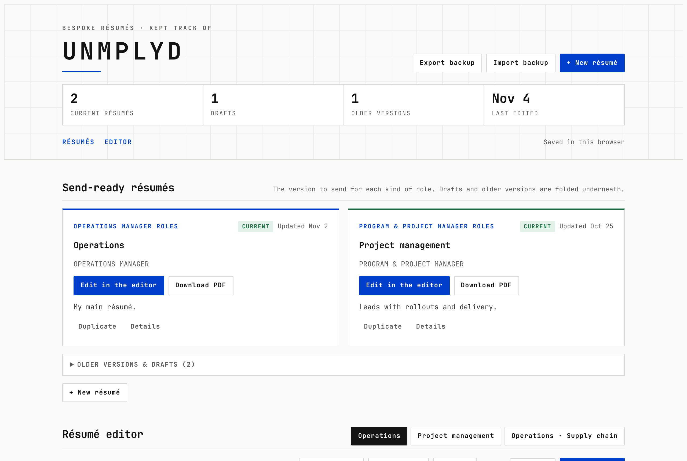
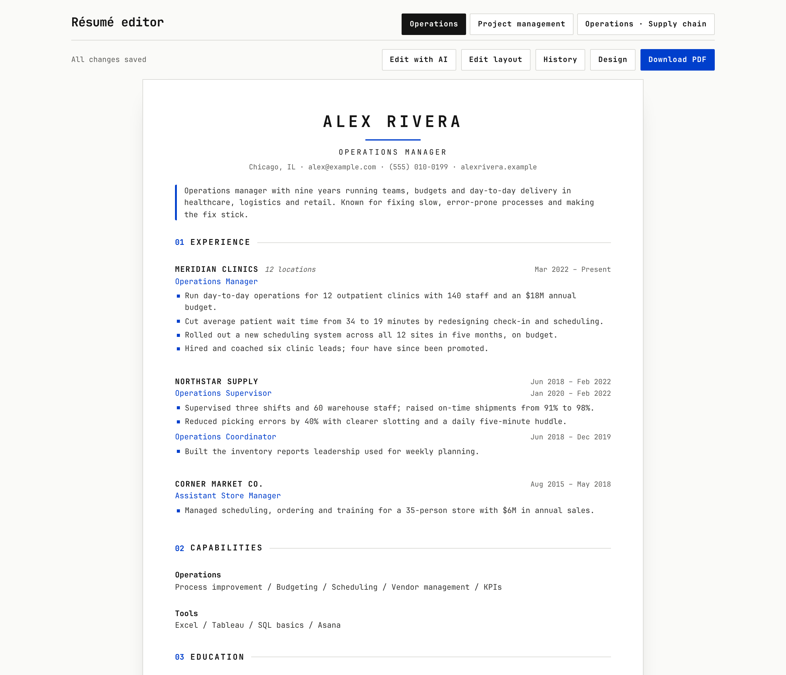

# unmplyd

**Bespoke résumés you can edit on the page, and keep track of.**

unmplyd is a single HTML file. Your résumé appears as a designed page: click any text to change it, and download a clean PDF when you're done. Keep one résumé for each kind of role, make tailored copies, and keep every version, so you always know which one is current and can go back to an older one.



## What you get

- **A designed résumé that you edit directly.** No forms and no templates to fill in. Click the text on the page and type. Enter adds a bullet; Backspace on an empty bullet removes it.
- **Edit layout** adds or removes jobs, roles, bullets and sections, and moves them up or down.
- **A résumé library.** Current résumés sit up top, one for each kind of role. Drafts and older versions are folded underneath. Duplicate one to make a tailored copy, and use Details to name it, say what it's for, set its status and add notes.
- **Version history** for every résumé. Save a version whenever you like. A version is also saved automatically before any AI edit, restore, or removal of a section or job. Preview any version and restore it in one click.
- **Accent colors**, so each résumé can have its own look.
- **Clean PDFs** in JetBrains Mono that applicant-tracking systems read correctly.
- **AI edits with any assistant.** No account or API key needed (see below).
- **Private.** Everything is saved in your browser. Export a backup file whenever you like.



## Get started

**Just open it.** Download the repository and open `index.html` in your browser. It starts with example résumés for a made-up person. Look around, then click **Start fresh**.

**Or serve it.** Serving the folder lets PDFs use the bundled JetBrains Mono font (opened straight from disk, they fall back to Courier, with the same layout):

```bash
git clone https://github.com/iclickthemouse/unmplyd.git
cd unmplyd
python3 -m http.server 8000
# open http://localhost:8000
```

**Or host your own copy.** Fork the repo and turn on GitHub Pages (Settings → Pages → Deploy from branch → `main`). Your data still stays in your own browser.

To add your résumé, click **+ New résumé**, choose *Text I paste in*, and paste your current résumé. The next step turns it into an editable, designed page, using any AI assistant.

## Editing with AI

unmplyd isn't tied to any AI model or company. It works by copy and paste:

1. Click **Edit with AI**. Say what you want, or pick a quick request: *Tighten bullets*, *Stronger verbs*, *Lead with results*, *Shorter*, or *Tailor to a posting* (paste the job description).
2. Click **Copy prompt** and paste it into whatever AI assistant you use, such as Claude.
3. Paste its whole reply back in and click **Review changes**.

You see every change, old next to new, before anything is applied. The prompt tells the assistant never to invent employers, titles, dates, numbers or results. The review flags any reply that changes a company name, date or job title anyway. Applying saves the previous version to History first.

## Rebuild it with an AI agent: SKILL.md

[`SKILL.md`](SKILL.md) describes unmplyd completely: the résumé format, the design, the editing behavior, version tracking and PDF export. An AI agent can use it to:

- convert someone's résumé into an import file for this app,
- rebuild the whole tool from scratch without this repository, or
- make designed résumé files and keep versions in plain folders.

Put it in your agent's skills folder (as `unmplyd/SKILL.md`), or paste it into a chat with any assistant.

## Your data

- Everything is saved in your browser's local storage on this device. Nothing is uploaded.
- Clearing your browser data erases it, so use **Export backup** now and then. Importing that file in another browser or on another computer brings everything across.
- The page loads its font from Google Fonts and the PDF library ([jsPDF](https://github.com/parallax/jsPDF)) from cdnjs. Neither receives any of your data.

## Backup format

```js
{
  "app": "unmplyd", "version": 2,
  "resumes":  [ { "id", "title", "target", "status": "current" | "draft" | "older", "notes", "accent": "#003FCC", "data": Résumé, "savedAt", "created" } ],
  "versions": [ { "id", "resumeId", "data": Résumé, "at", "note" } ]
}
```

A `Résumé` is `{ name, title, contact, summary, sections }`, with three kinds of section:

```js
{ "type": "experience", "heading": "EXPERIENCE",   "entries": [ { "company", "note", "dates", "roles": [ { "title", "dates", "bullets": [] } ], "bullets": [] } ] }
{ "type": "groups",     "heading": "CAPABILITIES", "groups":  [ { "label", "text" } ] }
{ "type": "lines",      "heading": "EDUCATION",    "lines":   [ { "bold", "text" } ] }
```

See [`examples/example-backup.json`](examples/example-backup.json) for a full example.

## Project layout

```
index.html                  the whole app: HTML, CSS and JavaScript in one file
SKILL.md                    the full spec, for AI agents
fonts/                      JetBrains Mono, embedded in PDFs
examples/                   the example data, as an importable backup
scripts/build_example.py    rebuilds the example data and embeds it in index.html
docs/                       screenshots
```

There's no build step. Edit `index.html` and reload.

## Contributing

Issues and pull requests are welcome. Please keep it a single file with no build step and no tracking, and run through the checks in [AGENTS.md](AGENTS.md) first.

## Credits

- Designed and built with [Claude](https://claude.ai)
- PDF export: [jsPDF](https://github.com/parallax/jsPDF) (MIT)
- Font: [JetBrains Mono](https://www.jetbrains.com/lp/mono/) (SIL Open Font License 1.1, see `fonts/OFL.txt`)

## License

MIT. See [LICENSE](LICENSE).
