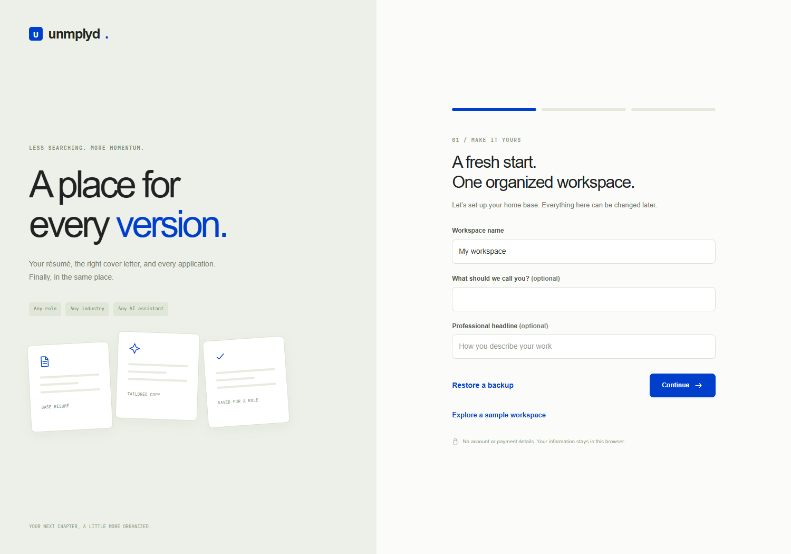

# unmplyd

**A place for every version.** A private application workspace for the résumé you
started with, the copy you tailored, the cover letter you wrote, and the exact
documents you chose for each role. Any occupation, industry, or AI assistant.

## Start here

    git clone https://github.com/iclickthemouse/unmplyd.git
    cd unmplyd
    npm start
    # open http://localhost:8000

Requires a recent Node.js release (20+). No npm install, framework build, account,
API key, or configuration file. Alternatively serve the repository using Python 3:

    python3 -m http.server 8000 --bind 127.0.0.1

Use a local HTTP server, not a file:// URL. The app can also run on ordinary
static HTTPS hosting. Use the same browser profile and origin to keep accessing
its local workspace; changing ports, hostnames, or browsers creates another store.

## Guided setup, then an actual workspace

1. **Make it yours.** Name the workspace; optionally add your name and headline.
2. **Bring your base résumé.** Import PDF, Word (.docx), Markdown, text, or a
   legacy résumé JSON file. Review the extracted text, or skip and add it later.
3. **Choose how you work.** Set optional role groups and writing preferences.

Setup progress saves as you go. Profile details, groups, writing preferences and
excluded claims remain editable in **Workspace settings**. No source edits needed.

| Workspace | What you can do |
|---|---|
| Overview | See your pipeline, interviews, due follow-ups, tasks, documents and recent packets. |
| Applications | Board or list view; filter by stage/group; search roles and notes; archive without losing history. |
| Role workspace | Keep the posting, contacts/notes, dates, follow-up, résumé copy, letter, attachments and saved packets together. |
| Documents | Keep a verified base, create role copies, edit plain text, save named versions, preview/restore history, export PDF or text. |
| Cover letters | Write or paste a draft, review AI revisions, save named versions, restore an earlier letter and export PDF. |
| Tasks | Add next steps, due dates and related applications; retain completed items. |
| Settings | Update preferences; export a full backup or merge one without overwriting existing records. |

## Tailor without losing your place

Open an application, choose **Documents**, and create a role-specific copy from a
base résumé. The base stays unchanged. **Tailor with AI** builds a factual prompt
from your résumé, role description and preferences. Copy it into any assistant,
paste its proposed plain-text draft back, compare it with the current version,
then save after review. No JSON response required. Cover letters work the same way.

No model is called by the app. No hidden matching/ATS scores. Review facts,
names, dates and claims yourself. The prompt asks for separate changes/questions;
paste only the document text back into the draft field.

## Ready is different from submitted

**Save ready packet** freezes the chosen résumé text, letter and attachment IDs.
It does not change application status. **Record submission** asks when you
actually applied and confirms which documents you sent, then saves a separate
submission record. New applications start as Lead with blank submission/contact
dates. Status changes never manufacture contact dates.

Later edits cannot change an earlier packet. Removing a file from the working
kit leaves its saved packet copy available. Export individual packets with their
file bytes or export the complete workspace. Archiving a role retains everything.

## Your data and files

Metadata lives in localStorage; original attachments live in IndexedDB. Everything
stays in this browser profile. There is no account server, encryption at rest,
automatic cloud backup, or cross-device synchronization. Other people using the
same browser profile can access it, and clearing site data removes it.

**Export full backup** includes documents, version history, application packets,
tasks, settings, migrated collections and all original attached files. Missing
file bytes cause an explicit error instead of silently producing an incomplete
backup. Keep backups privately. Restore merges records and remaps conflicting IDs
instead of overwriting current work; changed duplicates become separate copies.

If another tab saves changes, editing stops in the older tab until it reloads;
that tab can export its own copy first. Storage failures are visible, not reported
as successful saves. Avoid deleting browser data until you have a verified backup.

## Imports, exports and offline assets

- PDF, Word, Markdown and text imports become editable plain-text masters;
  layout and reading order need review. Scanned PDFs with no text require OCR
  elsewhere or pasted text; no content is fabricated.
- Résumé and letter PDFs contain selectable text and wrap onto multiple pages.
  The standard PDF font normalizes common punctuation and may replace unsupported
  characters; inspect names, non-Latin text and layout before sending.
- Attachment files are preserved as their original bytes, even when the editable
  text version has a different layout. File uploads are limited to 20 MB each.
- PDF export/import, Word import, fonts and scripts are bundled locally. No CDN
  or AI service is contacted. Static hosting still serves those local assets.

## Existing workspaces

The earlier document-store format is migrated on first open at the same origin.
Original browser keys and raw collections stay intact. Résumés, previous
versions, applications, packets, materials and tasks are preserved. Placeholder
demo data is archived rather than counted as real work. Available saved legacy
configuration is preserved, including retired claims and links. Configuration
that existed only inside a personally edited old HTML file cannot be recovered
from browser storage; keep that file/backup if you customized it.

Earlier remote-host adapters are not part of this local workspace. Export data
from the host before switching; no automatic remote service migration is claimed.

## Skill-only alternative

Download [SKILL.md](SKILL.md) and attach it to an assistant or paste its contents:
**“Use these instructions to organize my applications in my chosen private
folder. Start with my base résumé and this role description.”**

It maintains role folders, versioned drafts, a manifest and exact submission
snapshots without this app or repository installation. File access is optional:
without it the assistant returns files for you to save. The skill's folder
workflow does not automatically sync with this app.

## Development

    npm test
    npm run dev

20 unit tests cover state validation, storage errors, migration, immutable
snapshots, backup/reference merging, prompt guardrails, import errors and PDF
pagination. Browser verification covers onboarding, role copying, draft review,
packets/file retention, actual backup restore, PDF export/import, and phone layout.
See [AGENTS.md](AGENTS.md) and [inventory](docs/INVENTORY.md).

## Credits and license

MIT, see [LICENSE](LICENSE). Third-party notices retained in vendor/ and fonts/:
[jsPDF](https://github.com/parallax/jsPDF),
[PDF.js](https://github.com/mozilla/pdf.js),
[Mammoth](https://github.com/mwilliamson/mammoth.js),
[JetBrains Mono](https://www.jetbrains.com/lp/mono/).
